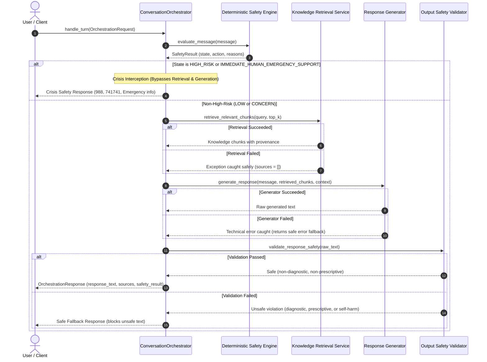

# Conversation Orchestration Foundation: Voca Mind (`voca-mind`)

This document describes the architectural foundation, execution pipeline, safety interception rules, and clinical boundaries of the **Conversation Orchestrator** (`backend/app/services/conversation_orchestrator.py`).

---

## ⚠️ Important Product & Non-Clinical Boundary

**Voca Mind is NOT a therapist, psychiatrist, medical practitioner, diagnostic system, or emergency service.**

- The Conversation Orchestrator does **NOT** diagnose mental-health conditions or determine medical diagnoses.
- The Conversation Orchestrator does **NOT** prescribe treatment or advise users to start, stop, or modify medications.
- The Conversation Orchestrator does **NOT** claim to replace human emergency or professional clinical mental-health care.
- The Conversation Orchestrator operates as a supportive wellness assistant coordinating non-clinical psychoeducation and conversational coping strategies.

---

## 1. Architectural Purpose & Coordination Flow

The `ConversationOrchestrator` coordinates four existing subsystems without relying on live external APIs or direct LLM safety compliance:
1. **Deterministic Safety Engine** (`backend/app/safety/engine.py`)
2. **Curated Knowledge Retrieval** (`backend/app/knowledge/retrieval.py`)
3. **Dialogue Response Generator** (`DeterministicFakeResponseGenerator` / injected protocol)
4. **Response Safety & Boundary Validator** (`backend/app/safety/output_validator.py`)

### 1.1 Turn Execution Sequence



---

## 2. Pipeline Stages & Safety Guarantees

### 2.1 Pre-Generation Crisis Interception
- Before invoking retrieval or text generation, incoming user messages are evaluated by the deterministic rule-based Safety Engine.
- If the evaluated state is `HIGH_RISK` or recommended action is `IMMEDIATE_HUMAN_EMERGENCY_SUPPORT`:
  - **Ordinary AI generation is completely bypassed.**
  - **Knowledge retrieval is completely bypassed.**
  - The orchestrator immediately returns a supportive, nonjudgmental safety response with verified emergency resources (e.g., 988 Suicide & Crisis Lifeline, Crisis Text Line 741741, emergency services).
  - Preserved `sources` list is empty (`[]`).
  - Flag `is_safety_diverted = True` is returned.

### 2.2 Knowledge Retrieval & Provenance Integrity
- Psychoeducational retrieval is only performed for non-high-risk messages (`LOW` or `CONCERN`).
- The orchestrator communicates with retrieval solely through an injected interface (`RetrievalProtocol`).
- **Safe Failure Handling:** If the vector database or embedding service encounters a network error or connection failure:
  - The error is logged safely without leaking sensitive text.
  - The orchestrator never invents sources or fabricates citations.
  - Dialogue generation continues with an empty context, ensuring the user is not left with an unhandled exception.
- Source provenance (`SourceProvenance`) is attached to the response **only** when retrieval actually returns verified knowledge chunks.

### 2.3 Response Generation & Offline Development
- Response generation is abstracted behind `ResponseGeneratorProtocol`.
- A deterministic `DeterministicFakeResponseGenerator` is provided for offline development and local unit testing.
- **Zero External API Calls:** No external network requests or OpenAI APIs are required during local development or test suites.

### 2.4 Post-Generation Safety & Boundary Validation
- Generative models can suffer from instruction drift or hallucination. Therefore, every generated text must pass a dedicated output validator (`validate_response_safety`) before reaching the user.
- **Checked Boundaries:**
  1. **Self-Harm / Crisis Content:** Evaluated via the Safety Engine; any acute risk triggers a block.
  2. **Medical Diagnostic Claims:** Blocks claims such as *"I diagnose you with depression"* or *"You meet the diagnostic criteria for bipolar disorder"*.
  3. **Prescriptive Medication Advice:** Blocks advice directing users to start, stop, take, or modify medications (e.g., *"You should start taking 20mg of Prozac"*, *"Stop taking your medication"*).
- **Fallback Behavior:** If validation fails, the unsafe generated text is suppressed and replaced with `SAFE_FALLBACK_RESPONSE`, setting `fallback_triggered = True` and `fallback_reason = "UNSAFE_OUTPUT_BLOCKED"`.

---

## 3. Privacy & Data Isolation Guarantees

1. **No Conversation Persistence into Knowledge Base:**
   - Raw user conversation turns are **never** indexed or written into the Qdrant vector store or knowledge base.
2. **Privacy-Preserving Logging:**
   - Operational logs record only message lengths, session IDs, safety states, reason codes, chunk counts, and error types.
   - Raw mental health statements, generated dialogue texts, access tokens, and API secrets are **never** written to log streams.

---

## 4. System Limitations

1. **Rule-Based Foundation:** The deterministic Safety Engine provides a baseline safety foundation, but cannot replace a comprehensive clinical triage system or human crisis worker.
2. **Not Clinically Certified:** This implementation is not certified as a medical device or diagnostic instrument.
3. **Non-Sole LLM Safety:** Generative LLMs must never be the sole mechanism for safety enforcement; multi-stage deterministic pre-checks and post-checks are strictly required.

---

## 5. Running Tests

All unit tests for the Conversation Orchestrator run locally without database or network connections:

```powershell
# From the backend directory
cd backend

# Run Conversation Orchestrator unit tests
.venv\Scripts\pytest -v tests/test_conversation_orchestrator.py

# Run the full backend test suite
.venv\Scripts\pytest
```
